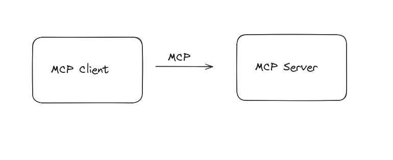
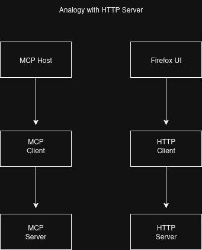
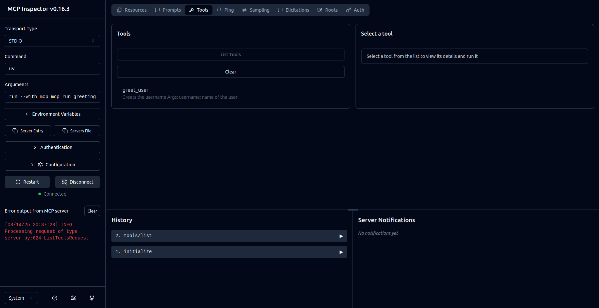

# MCP Guide

MCP is an open protocol that standardizes how applications provide context to large language models (LLMs).



## System information setup

List of required tools.

1. [GitHub account](https://github.com/)
2. [VS Code](https://code.visualstudio.com/)
   1. [GitHub copilot extension](https://marketplace.visualstudio.com/items?itemName=GitHub.copilot)
3. [Python](https://www.python.org/downloads/)
4. [uv](https://docs.astral.sh/uv/getting-started/installation/)
5. [npm](https://nodejs.org/en/download)

## Introduction

MCP is a like USB-C port for AI applications.

- USB-C provides a standard to connect to different devices and accessories.
- In a similar way, MCP is standard to connect AI models to data sources and tools.

## MCP architecture overview

Server client architecture.

**Components:**

1. **MCP Host (VS Code GitHub Copilot):** The AI application that coordinates and manages one or multiple MCP clients.
2. **MCP Client:** A component that maintains a connection to an MCP server and obtains context from an MCP server for the MCP host to use.
3. **MCP Server:** A program that provides context to MCP clients.

Analog with HTTP Server.



Keep the MCP Server as modular as possible, so that they can be reused.

MCP Client <-> MCP Server <-> Tool A1, Tool A2, ..., Tool AN
                          <-> Prompts
                          <-> Resources

To connect to multiple MCP server, host starts multiple mcp clients. For example,
firefox opens multiple tab to connect to different web applications.

### MCP Layers

1. **Data Layer:** Using JSON-RPC based protocol for client-server communication.
2. **Transport Layer:** The communication mechanism includes auth, message framing, connection establishment. (Stdio, streamable http)



### Tools

It must have following fields.

| Parameter | Purpose | Example |
| :-------- | :------ | :------ |
| Name | Of tool or function | get meal details |
| Description | what it does and what are expected arguments | get meal details |
| Input Schema | Dictionary of arguments | { "meal_name": "string" } |

### Resources

1. To share file contents, user data and other things. For example, your bank statement to categorize them into different categories.
2. Your notes for easy searching.

### Prompts

List of prompts as a template, provided to the user.

## FastMCP vs Low Level Server

In every SDK from [modelcontextprotocol](https://github.com/modelcontextprotocol), we have below structure:

mcp/python-sdk -> src/mcp/server:

1. FastMCP
2. LowLevel

The lowlevel was original implementation of mcp server.
FastMCP is a wrapper over lowlevel.

### MCP Protocol

Depends where the server is located. Used to interact with client and server.

#### Local

Server lives on te same machine as the client.

STDIO

Define the mcpServer config. It tells about the server name, and from where to download the server file. For example, if you have setup an npm server and published on npm, then it will take npx as an input and path to the repo to install and run it.

#### Remote

Use remote server, and use HTTP or SSE as a communication protocol. SSE is deprecated.
Server is run on a virtual machine, running on your company infrastructure and all mcp clients can connect to this mcp server.

Just provide the url where server is running.

## Creating an MCP Server

We will be using python for this exercise, as it is easy to setup and learn.

1. Create a new directory for your MCP server.
2. Initialize it using `uv init`.
3. Setup the virtual environment `uv venv`.
4. Add the `mcp[cli]` and `httpx` as dependencies.
5. Write the code inside your app.py.

## Test using mcp inspector

uv run mcp dev app.py

### Writing tools in MCP server

It will call the function directly written in python.

#### MCP server to print name

A simple MCP Server to greet the user.

#### MCP server with local files

- local.py
- notes.md

Demo on Getting the data and storing the data in a local file.
It would be good to information with available ingredients and cook meals.

- Saving screenshots

#### MCP server with API request

Thanks to [themealsdb](https://www.themealdb.com/api.php) for providing public api for nice list of meals.

#### MCP server with complex inputs

- Using pydantic objects

### Using mcp prompts

Have an MCP server instead of creating a text file, you can use the MCP prompts to create a template for the user to fill in.

### Using MCP resources

With resources we can provide the information to the tool and provide to AI models as context.

## Model deployment

1. Package the server and distribute it.
pyproject.toml is used for packaging.

```txt
project_folder
- src
  - server
    - __init__.py
    - __main__.py
    - app.py
```

The python file(s):

```python
#__main__.py
from server.app import mcp

def main():
  mcp.run()

if __name__ == "__main__":
  main()
```

Run the code using below `uv` command:

```bash
uv run src/app/__main__.py
```

And, can also be run like this with packaging.

```bash
uv run mcp-app (name from pyproject.toml file)
```

Once the testing is successful, we can push to github repo and run it like below:

```bash
uvx --from git+https://github.com/sarvsav/mcp-meals-server.git mcp-app
```

## MCP client connecting to local machine

MCP Server is running locally. For example, with Linear server, we can see it tricks the client that it is running
locally using [mcp-remote node package](https://www.npmjs.com/package/mcp-remote).

node package - mcp-remote

## Using remote server

The default transport is `stdio`, if updated to `transport="streamable-http"` then it will work on http and can be used remotely, by just providing the url field.

Thanks to [oleksandrsirenko](https://github.com/oleksandrsirenko/mcp-simple-server), for providing curl commands to debug mcp server locally without inspector.


## Minimal curl recipe

For curl requests:

[08/12/25 15:04:15] INFO     Created new transport with session ID: 4410b3c0b0a841229768a80132d49030

```bash
curl -X POST http://localhost:8000/mcp \
  -H "Content-Type: application/json" \
  -H "MCP-Protocol-Version: 2025-06-18" \
  -H "Accept: application/json, text/event-stream" \
  -d '{"jsonrpc":"2.0","id":1,"method":"initialize","params":{"protocolVersion":"2025-06-18","capabilities":{"tools":{}},"clientInfo":{"name":"test-client","version":"1.0.0"}}}'

  curl -X POST http://localhost:8000/mcp \
  -H "Content-Type: application/json" \
  -H "MCP-Protocol-Version: 2025-06-18" \
  -H "Accept: application/json, text/event-stream" \
  -H "Mcp-Session-Id: 4410b3c0b0a841229768a80132d49030" \
  -d '{"jsonrpc":"2.0","method":"notifications/initialized"}'

  curl -X POST http://localhost:8000/mcp \
  -H "Content-Type: application/json" \
  -H "MCP-Protocol-Version: 2025-06-18" \
  -H "Accept: application/json, text/event-stream" \
  -H "Mcp-Session-Id: 4410b3c0b0a841229768a80132d49030" \
  -d '{"jsonrpc":"2.0","id":2,"method":"tools/list"}'

  curl -X POST http://localhost:8000/mcp \
  -H "Content-Type: application/json" \
  -H "MCP-Protocol-Version: 2025-06-18" \
  -H "Accept: application/json, text/event-stream" \
  -H "Mcp-Session-Id: 4410b3c0b0a841229768a80132d49030" \
  -d '{"jsonrpc":"2.0","id":3,"method":"tools/call","params":{"name":"greet_user","arguments":{"username": "azi"}}}'
```

## MCP Server with memory

Using vector store.

## Thanks

Thank you for joining and supporting. I really appreciate it.

## Credits

1. [MCP Documentation](https://modelcontextprotocol.io/docs/getting-started/intro).
2. Henry From IntelligentWorker.
3. Contributors and Audience.
